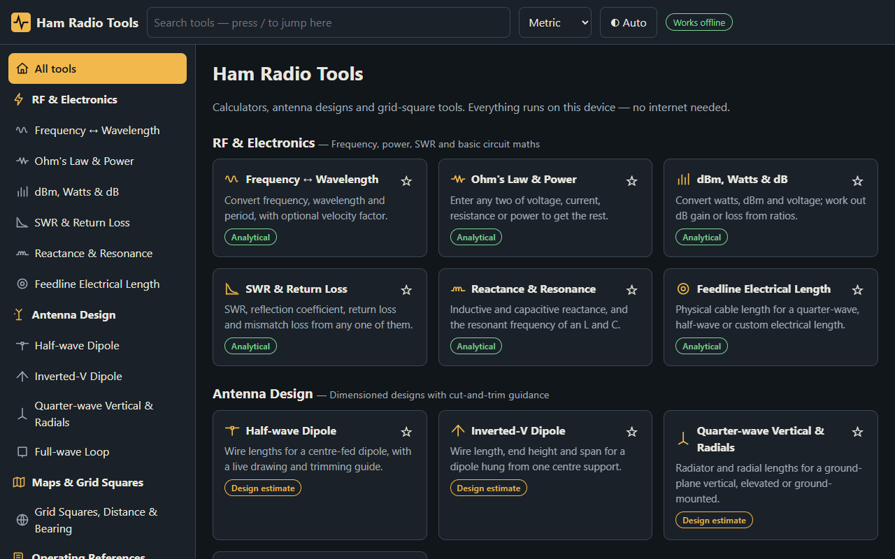
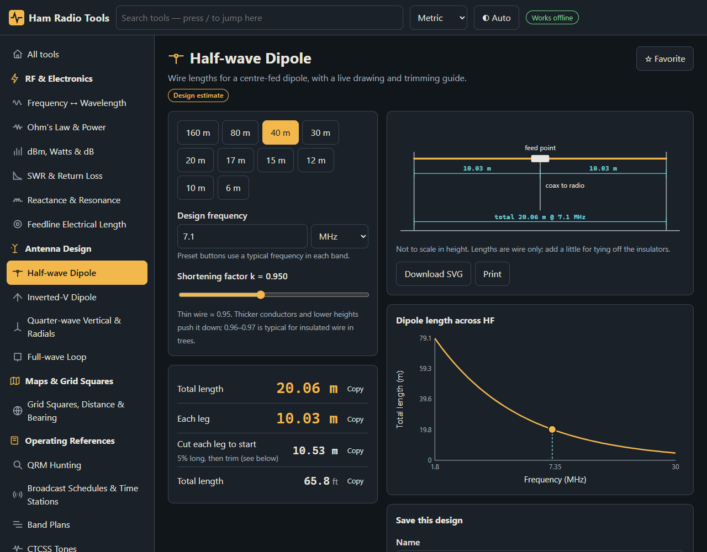
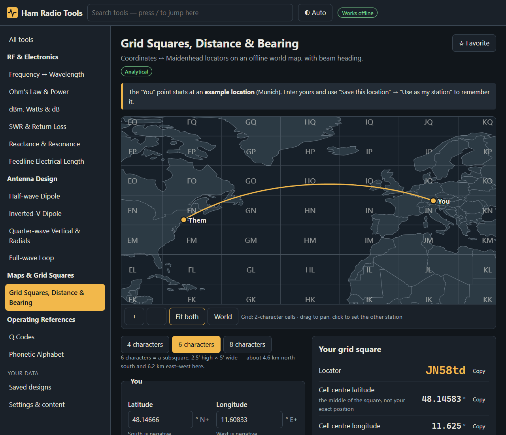
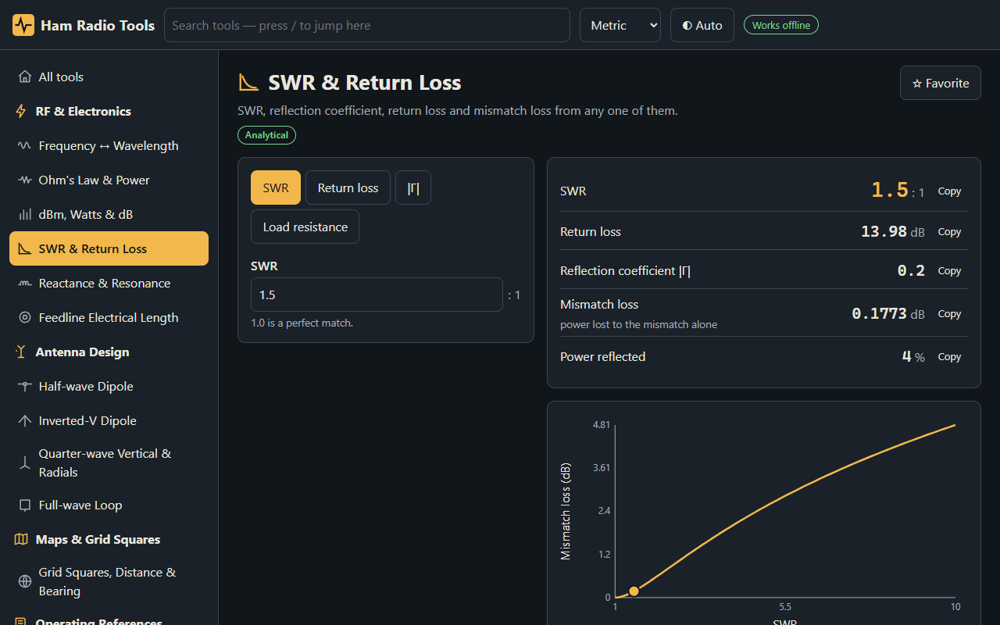

<b>Your amateur-radio workbench: calculate, design, build and operate.</b>

<a href="https://hamradiotools.armysarge.co.za/">Try it in your browser</a> · <a href="https://hamradiotools.armysarge.co.za/#/downloads">Downloads &amp; installation</a> · <a href="https://github.com/armysarge/ham-radio-tools/releases">GitHub releases</a> · <a href="ROADMAP.md">Roadmap</a>

Ham Radio Tools is a free, open-source collection of practical tools for radio amateurs, made by **ZS6SHZ**. Get a quick answer, explore an illustrated design, or expand an explanation to understand the method.

## Screenshots

| Dashboard | Dipole designer |
|---|---|
|  |  |
| Offline map and grid tools | SWR calculator |
|  |  |

> **Early release:** antenna designs are starting estimates. Measure and tune your finished antenna with an analyser. Check your current licence and local rules before transmitting.

## What can I do with it?

In **Band Plans**, enable **Show all radio services** to include aviation, maritime, broadcasting, satellite and other services in the existing frequency lookup, interactive chart and table. Filter by service and frequency range. Bundled data covers all three ITU regions (2024) and Canada’s national table (2026). Other countries combine clearly labelled regional service rows with their national amateur licence details; regional rows do not replace national rules. Everything works offline.

| Area | Tools |
|---|---|
| RF & electronics | Frequency and wavelength, Ohm's law, power, dB/dBm, SWR, reactance, resonance, component colour codes, DIY baluns and RF transformers |
| Antenna building | Dipole, inverted-V, EFHW, vertical, J-pole, full-wave loop, QFH satellite receive design, Yagi and quad; dimensions, materials, build guidance and clearly qualified pattern illustrations |
| Station planning | Feedline loss, link budgets, matching networks, filters, coils, toroids, batteries and solar |
| Maps | Offline world map, Maidenhead grids, saved locations, distance and bearing |
| Operating | Band tables, callsign lookup, Q codes, phonetics, CTCSS and DCS codes, clocks and timers |
| CW & logging | Morse player and trainer, experimental decoder, logbook with ADIF import/export |
| Listening & propagation | QRM hunting and a sniffer-loop build guide, broadcast schedules, grey line, MUF estimates, a band-by-hour **propagation report** between two places (built-in DVOACAP model, offline) and satellite passes from your own TLE |
| DIY components | Build coils, capacitors, dummy loads and ferrite chokes; calculate balun/transformer turns and material lengths, with winding diagrams and cable guidance |

Search for a tool, add favourites, choose Metric or Imperial, and switch between light and dark themes. Sidebar categories start collapsed and remember which ones you open. Open **Show** below a tool for its explanation and references.

**Converting a location or measurement?** Coordinate Converter accepts decimal degrees, degrees/minutes and DMS, shows the point and its Maidenhead cell on the offline map, and saves named locations. Unit Converter handles twelve quantities, including metric/imperial lengths, component values, watt-hours/joules and Celsius/Fahrenheit. Both work entirely offline.

**Planning your RF chain?** ERP & EIRP combines transmitter power, feed-system loss and antenna gain, with clear dBi/dBd references. Low-pass and high-pass filter designers show live pi/T connection diagrams, component values and ideal attenuation curves. Real filters need suitable RF components and measurement after construction.

**Heard “73” or “72” on air?** Number Codes & 92 Code explains common number shorthand with examples and Morse notation, keeping historical telegraph examples separate from current amateur usage.

**Understanding antenna matching?** SWR / VSWR & Return Loss also accepts voltage maxima/minima and shows a live standing-wave envelope. It explains the ratio and reflected power without treating reflection as heat loss.

The **Cubical Quad Beam** designer includes a rotatable 3D construction drawing. Adjust its viewing angles to see the separate loops, spreaders and boom; use the table for cutting lengths and spacing.

**Building a balun or transformer?** DIY Baluns & Ununs has selectable **1:1 coax choke**, **1:1 paired-wire current**, **4:1 Guanella current**, **4:1 Ruthroff voltage** and **9:1 voltage unun** templates, with their own connection drawings, material choices and turns estimates. The two-section current balun accounts for both independent core stacks and all four conductors; the unun shows its three equal windings and shared return. Open **DIY Components → RF transformer** for a conventional two-winding transformer's turns and wire allowance. Calculated turns do not guarantee RF bandwidth or power handling. Build and measure for your intended bands.

Antenna tools include dimensioned drawings, material guidance and a short **Recommended bands and uses** section to help you choose a suitable build. Each guide explains common band choices and any single-band, harmonic or receive-only limits. The QFH drawing shows the helical paths around the mast plus top and bottom views, which move below the main drawing on smaller screens. Where **Download SVG** is available, exported diagrams retain the displayed colours, label sizes and line styles. Radiation-pattern illustrations explain concepts; they are not simulations of your installation.

Dipole, inverted-V and horizontal EFHW drawings also show frequency-dependent height references. The guides explain general HF/DX and regional/NVIS choices; there is no single optimal height for every site. The inverted-V shows your entered apex height separately from the reference.

## Use it on your computer

**Browser:** open the [demo](https://hamradiotools.armysarge.co.za/). The hosted site needs a connection to load. For reliable use away from the internet, use a locally installed desktop build or serve the downloaded web bundle locally.

**Windows and Linux:** Electron desktop packaging is available for testing. When desktop assets are attached to a [release](https://github.com/armysarge/ham-radio-tools/releases), Windows uses an `.exe` installer; Linux uses an `.AppImage` or `.deb`. Node.js is bundled with Electron, so users do not install it separately. See the [desktop testing guide](docs/DESKTOP.md) to run or package it from source.

The desktop and standard web builds bundle the calculators, diagrams, reference tables and basic world map. No account is needed. In Electron, use **Settings & content → Desktop updates** to check for a release and choose whether to download it. Nothing checks or downloads automatically. Windows can open the downloaded installer after confirmation; Linux shows the AppImage for manual replacement.

## Your saved work

Data stays on your device in the browser profile or the desktop app's own profile. Different browsers, site addresses and the desktop app have separate data.

- **Designs and locations:** Settings & content → **Export project file**. Import that JSON file on another device.
- **Logbook:** use **Export ADIF** regularly. The logbook is backed up separately from projects.
- Clearing browser site data removes its saved work. Keep exported copies somewhere safe.

## Band tables and content packs

Band tables for the **USA, South Africa, Canada, Germany, Australia, Japan and Brazil** are included. Their scope varies; Australia currently covers Advanced licence holders. Each table displays its source and date. UK and India are awaiting verified source documents.

Filter by band or search for a frequency. Expand the allocation chart to inspect entries interactively alongside the table.

To add a schedule or regional plan, import its JSON pack under **Settings & content**. That screen can also convert a supported EiBi-layout or CSV shortwave schedule. Packs can be carried on a USB drive. Schedules are dated and show a warning when old; downloads are your choice. [Data sources and pack details](docs/DATA_SOURCES.md).

**On the air now** shows scheduled stations and frequencies from all bundled schedules and every installed broadcast pack using the device's current UTC clock. It updates locally while you browse other times and respects station/frequency filters. Entries are grouped by source with revision dates and stale-data warnings; the schedule dropdown controls only the detailed table. Entries indicate scheduled activity, not confirmed reception or transmitter status.

Choose **BBC World Service · 2026–27 season** in Broadcast Schedules & Time Stations for the bundled frequency reference from **25 October 2026 to 27 March 2027**. Medium-wave and DRM entries are labelled. Outside that season, live matches are disabled and “Everything” shows dated reference rows. This is a frequency schedule, not a programme guide.

## Privacy and offline use

The desktop and standard web builds have no analytics or background update checks. The hosted demo offers optional Google Analytics after you accept its consent banner; you can change that choice in Settings. Your saved projects, logbook and search text are not deliberately included in page-view events.

The CW microphone decoder processes audio locally and asks for microphone permission. It is experimental. Satellite predictions need a recent element set supplied by you.

## Development and releases

- [Run, test and build the web app](docs/DEVELOPMENT.md)
- [Test and package Electron on Windows or Linux](docs/DESKTOP.md)
- [Create versioned GitHub releases](docs/RELEASING.md)
- [Roadmap](ROADMAP.md) · [Changelog](CHANGELOG.md) · [Contributing](CONTRIBUTING.md)
- [Data sources](docs/DATA_SOURCES.md) · [Third-party notices](THIRD_PARTY_NOTICES.txt)

## Support the project

Report problems or suggest tools through [GitHub Issues](https://github.com/armysarge/ham-radio-tools/issues). Include the tool name, inputs and expected result when reporting a calculation problem.

If a tool fails to open, include your app version, operating system, affected tool and last action in your issue. When testing from source, restart Electron after rebuilding to use the latest app.

MIT licensed — see [LICENSE](LICENSE). Map data: Natural Earth, public domain. The app uses Vue, satellite.js and other credited open-source libraries. The it-tools project inspired its tool organisation; no it-tools code or assets were copied.

[Buy ZS6SHZ a coffee](https://www.buymeacoffee.com/armysarge). 73!
