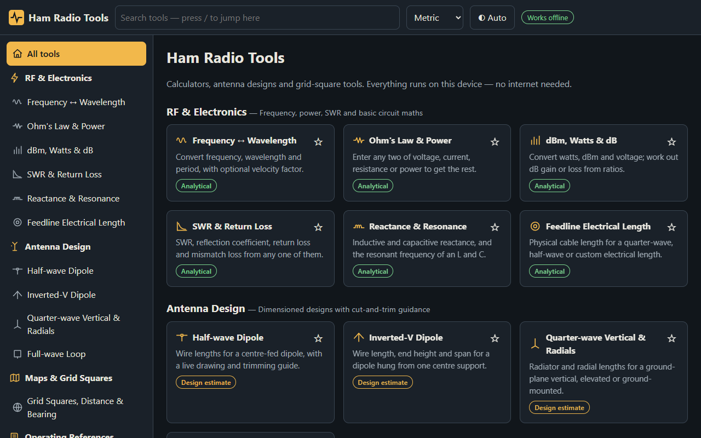
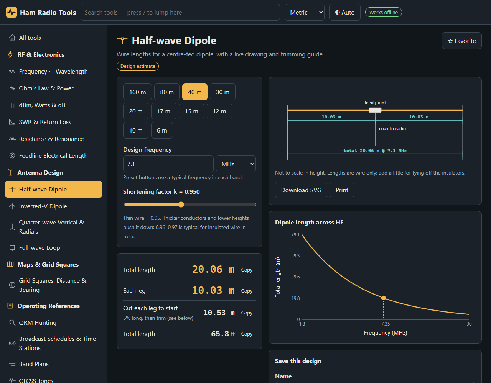
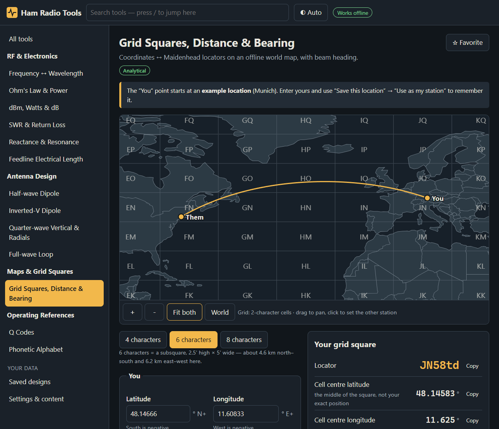
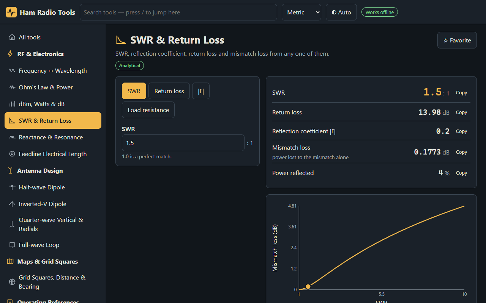
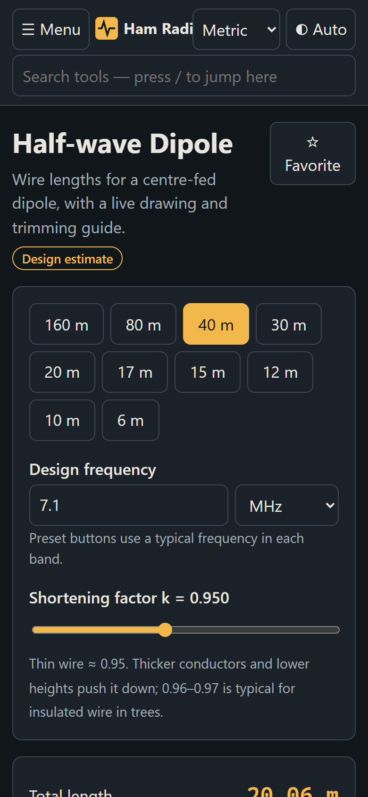
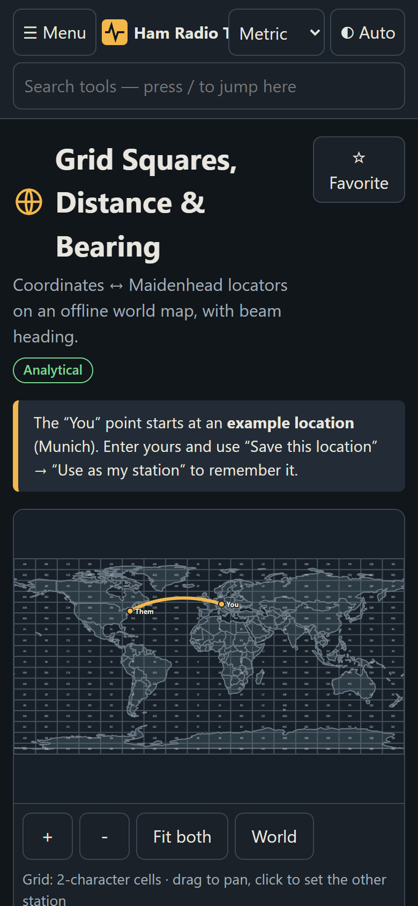

<p align="center">
  
</p>

<p align="center"><b>An offline-first amateur-radio workbench: RF calculators, antenna designers and grid-square tools that never need the internet.</b></p>

<p align="center">
  
  
  
  
  
  
</p>

<p align="center">
  <a href="https://www.buymeacoffee.com/armysarge"></a>
</p>

---

> ## ⚠️ Alpha Software
> Ham Radio Tools is in early development. Calculations are covered by tests and reference values, but antenna designs are **empirical design estimates, not simulations**. Always verify a finished antenna with an analyser, and use the app at your own risk.

## Screenshots

| | |
|---|---|
|  |  |
| Dashboard with search, categories and favorites | Dipole with a live, dimensioned drawing |
|  |  |
| Maidenhead grid, distance and bearing on the bundled map | SWR, return loss and mismatch loss |

| Phone: dipole | Phone: map |
|---|---|
|  |  |

## Overview

Ham Radio Tools gives beginners, experienced operators and antenna builders a quick answer first, then lets them expand the explanation to see the formula and assumptions behind it.

Key design goals:

- **Offline by design** — no CDNs, hosted APIs, telemetry, update checks or online map tiles. Everything runs on the device.
- **Honest numbers** — every tool is labelled *Analytical*, *Design estimate* or *Reference*, shows its sources, and states its limits.
- **Easy to use** — large text, big touch targets, plain labels, specific validation messages, light/dark themes, works on phones and tablets.
- **Easy to extend** — a tool is one Vue file plus one entry in a typed registry.

## Features

| Area | Feature |
|---|---|
| **RF & electronics** | Frequency ↔ wavelength with velocity factor · Ohm's law and power (any two in, rest out) · dBm / watts / dB ratios with impedance assumptions · SWR, return loss, reflection coefficient, mismatch loss · Reactance and LC resonance · Feedline electrical length |
| **Antenna design** | Half-wave dipole with trim helper · Inverted-V (apex angle, span, end height) · Quarter-wave vertical with elevated or ground radials · Full-wave loop (square, triangle, circle) with a 75 Ω matching section · Dimensioned SVG drawings · Save, export SVG, print |
| **Maps & grid squares** | Coordinates ↔ Maidenhead (4, 6 or 8 characters) · Cell edges vs. cell centre · Short- and long-path distance and bearing · Bundled offline world map with grid overlay, pan and zoom · Saved named locations and "my station" |
| **Projects** | Export saved designs and locations to a JSON file; import by adding or replacing; invalid entries are skipped with a reason |
| **Operating references** | Phonetic alphabet · Q codes |
| **App** | Search (`/` to focus) · Categories · Favorites · Light/dark/auto theme · Text size · Metric/imperial · Local persistence |

## Requirements

| Requirement | Notes |
|---|---|
| Node.js 20+ | Developed on Node 24 |
| npm | Comes with Node |
| Edge or Chrome | Only for `npm run check:offline` and `npm run screenshots` |

> **Development needs the network once** (`npm install`). **Running the built app never does.**

## Quick Start

1. Clone the repository

   ```bash
   git clone https://github.com/armysarge/ham-radio-tools.git
   cd ham-radio-tools
   ```

2. Install dependencies (the only step that needs internet)

   ```bash
   npm install
   ```

3. Start the dev server and open http://localhost:5173

   ```bash
   npm run dev
   ```

4. Run the tests

   ```bash
   npm test
   ```

5. Build the offline bundle

   ```bash
   npm run build
   ```

   `dist/` is plain static files with relative paths. Browsers refuse ES modules from `file://`, so serve it from any local static server (`npx vite preview`) or, later, the desktop shell. This is a limit of web builds, not a network dependency.

6. Verify it really works offline

   ```bash
   npm run check:offline
   ```

## Offline guarantees

| | Dev-time (needs download) | Runtime (must work offline) |
|---|---|---|
| What | npm packages, Vite, TypeScript, Vitest | Everything in `dist/`: code, fonts (system stacks), icons, diagrams, basemap |
| When | Once, by a developer | Always, including on a machine that has never been online |

- No service worker, so this is **not** a PWA that depends on a prior online visit.
- A Content-Security-Policy in `index.html` restricts loads to the app's own origin.
- `npm run check:offline` scans `dist/` for external URLs, then drives the built app in a real browser with **every non-localhost request blocked and recorded**: start-up, search, calculators, dipole save, map and locator, persistence across reload, a project export → delete → re-import round trip, and a 375 px phone pass (no horizontal overflow on any page, menu drawer works).
- **Not yet done:** the separate clean-machine installation check — it needs a packaged installer, which doesn't exist yet.

**What has actually been tested:** Windows 10 (build 19045), Node 24, Microsoft Edge via Playwright, Vitest/jsdom. Linux, macOS, Firefox, Safari and real phones/tablets are **untested**. Visual review was at 375 px and 768 px, mostly in dark theme. On phones the map supports touch pan; pinch-zoom is not implemented (use +/−).

## Project files

**Settings & content → Back up or move your projects** writes `ham-radio-tools-project-YYYY-MM-DD.json` containing saved designs, saved locations and which location is your station (format `ham-radio-tools-project`, version 1). Theme, units and favorites are per-device and not included. Import previews the file first, then either **adds** items (existing ids are never overwritten; importing the same file twice changes nothing) or **replaces** everything after an explicit confirmation. Files from a newer app version, files over 5 MB, and anything not in this format are refused with a readable message.

## Content on this device

| Content | Status |
|---|---|
| App, calculators, diagrams | Bundled |
| World basemap (Natural Earth 1:110m, public domain) | Bundled — country outlines only |
| Regional map packs, band plans, manual library, local AI | Unavailable (planned) |

Future packs will be separate folders imported from a file or USB stick and listed as *Bundled*, *Installed* or *Unavailable* under **Settings & content**. No import mechanism exists yet.

## Calculation references and known limitations

| Tool | Method | Limits |
|---|---|---|
| Wavelength | λ = c·VF/f, c = 299 792 458 m/s | VF is user-supplied |
| dBm / dB | 10·log₁₀(P/1 mW); 20·log₁₀ for voltage | Voltage dB assumes equal impedances (stated in the UI) |
| SWR family | Γ-based relations; resistive load Γ = (R−Z₀)/(R+Z₀) | Lossless line; resistive loads only |
| Reactance / resonance | X_L = 2πfL, X_C = 1/(2πfC), f₀ = 1/(2π√LC) | Ideal components; no Q or bandwidth |
| Feedline length | L = (θ/360)·c·VF/f | VF presets are typical values; check the datasheet |
| Dipole | L = k·c/2f, k = 0.95 (≈ 468/f ft) | Empirical. No pattern, impedance, bandwidth, height or ground modelling |
| Inverted-V | Dipole length × sloping-leg factor 0.97; span/drop by trigonometry | Empirical. Impedance guidance is qualitative |
| Vertical | k·c/4f for radiator and resonant radials, k = 0.95 (≈ 234/f ft) | Empirical. Radial counts are common guidance, not computed |
| Full-wave loop | k·c/f, k = 1.0218 (≈ 1005/f ft); 75 Ω quarter-wave match | Empirical. Feed impedance is qualitative; match is single-frequency |
| Locator | Integer cell arithmetic; cell edge belongs to the north-east cell; lon 180 → −180; lat 90 → top row | A locator is a cell, not a point |
| Distance / bearing | Haversine, R = 6371.0088 km; forward azimuth; long path = circumference − short | Sphere: up to ~0.5% vs. the ellipsoid; true (not magnetic) bearings; undefined for coincident or antipodal points |

Band-preset buttons are convenience design frequencies, **not** a band plan; allocations differ by country. The Q-code list is a paraphrased common set, not a verbatim ITU list.

## Architecture

```
src/lib/        pure calculation code (rf, antenna, maidenhead, geo, units) — no Vue, fully unit-tested
src/data/       reference data kept apart from logic (Q codes, band presets)
src/core/       registry.ts (typed tool list, categories, search) · store.ts (settings, favorites, locations, designs → localStorage)
src/components/ NumField (unit-aware validated input, v-model is canonical SI), ResultRow, ToolLayout, LineChart, WorldMap, LocationInput, DesignActions
src/tools/      one .vue per tool, lazy-loaded
src/views/      dashboard, settings, saved designs
src/platform/   the only place for OS-level access (file save, clipboard)
tests/          lib maths + UI workflows
scripts/        offline acceptance check, screenshot generator
```

Canonical units are Hz, m, W, Ω and degrees; display units are a UI concern in `NumField`.

### Adding a tool

1. Put the maths in `src/lib/` with tests in `tests/`.
2. Create `src/tools/MyTool.vue`: wrap it in `<ToolLayout id="my-tool" :references="[…]">`, use `NumField` / `ResultRow`, and put the formula and assumptions in the `#explain` slot.
3. Add one entry to `tools` in `src/core/registry.ts` (id, title, category, kind, keywords, lazy import). Routing, sidebar, search and favorites follow automatically.

## Desktop wrapper recommendation: Tauri 2

| | Tauri | Electron |
|---|---|---|
| Installer / memory | A few MB, OS webview, low RAM | ~80–150 MB, extra Chromium process |
| Offline install | Windows needs WebView2 (present on Win 10/11; offer the offline bootstrapper for old PCs); Linux needs WebKitGTK from the distro | Chromium bundled: nothing to install |
| Filesystem / serial / permissions | Explicit, allow-listed commands and scoped capabilities (fits "no unrestricted shell") | Broad Node access unless carefully sandboxed |
| Large map / manual packs | Read from the app data dir via scoped FS | Same |
| Local AI | Sidecar process (e.g. llama.cpp) started by an explicit command | Same, easier JS bindings |
| Risk | Webview differences between OSes — test each | Bigger and heavier; consistent rendering |

Recommendation: **Tauri**, because size, memory and a narrow permission model match this project and the app code stays plain web. Electron is the fallback only if WebKitGTK inconsistencies prove painful. Nothing in `src/` depends on either; native access goes through `src/platform/index.ts`.

## Roadmap

- [x] App shell, search, categories, favorites, themes, mobile layout
- [x] Frequency, Ohm's law, dB/dBm, SWR, reactance, feedline calculators
- [x] Dipole, inverted-V, vertical and loop designers
- [x] Maidenhead, distance/bearing, bundled offline map, saved locations
- [x] Offline acceptance check
- [ ] Morse reference and audio practice, UTC/local time and timers
- [ ] Regional band-plan packs (jurisdiction, source, revision date)
- [x] Saved-project export/import (JSON file)
- [ ] Regional map packs (evaluate MapLibre GL + PMTiles) and pinch-zoom
- [ ] Tauri shell and clean-machine install tests on Windows and Linux
- [ ] J-pole, end-fed, matching networks, Yagi (documented methods only)
- [ ] Manual library (user-imported PDFs, local search; OCR later) — no bundled radio-manual library is promised
- [ ] Optional local AI with page-level citations and no cloud fallback
- [ ] Narrow native utilities (serial discovery, checksums) via explicit commands

## Data, licenses and attribution

- **Reference project:** [it-tools](https://github.com/CorentinTh/it-tools) (GPL-3.0) was reviewed for ideas only — per-tool modules in a central registry, categories, and easy tool scaffolding. **No code or assets were copied.**
- **Basemap:** Natural Earth 1:110m countries (public domain) via `world-atlas` 2.0.2 (ISC, © Michael Bostock), compiled into the app.
- **Runtime dependencies:** Vue, vue-router (MIT), topojson-client (ISC). Fonts: none bundled (system stacks).
- Each tool's *Sources & references* panel names the handbooks used for the **methods**; no text was copied.

## Security & privacy notes

- Nothing leaves the device. Settings, favorites, locations and saved designs live in this browser's `localStorage`; clearing site data erases them.
- If the browser blocks storage, the app still works and says so in **Settings**.
- Antenna voltages are high at wire ends — keep them insulated and out of reach (the inverted-V tool warns about low ends).

## Contributing

1. Fork the repository
2. Create a branch (`git checkout -b feature/my-tool`)
3. Add your tool with tests, then run `npm test` and `npm run build`
4. Commit and open a pull request

See [CONTRIBUTING.md](CONTRIBUTING.md) for details.

## License

MIT — see [LICENSE](LICENSE).

## ☕ Buy me a coffee

If Ham Radio Tools saved you a trip to the shack, consider supporting its development.

<p align="center">
  <a href="https://buymeacoffee.com/armysarge"></a>
</p>
